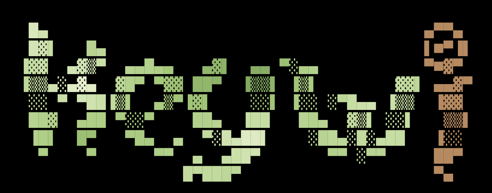
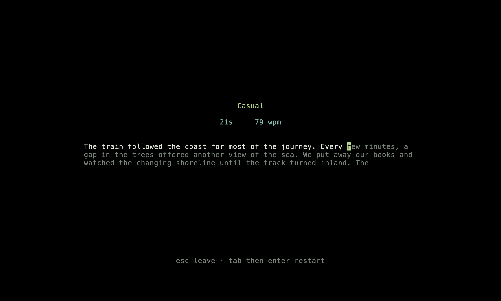
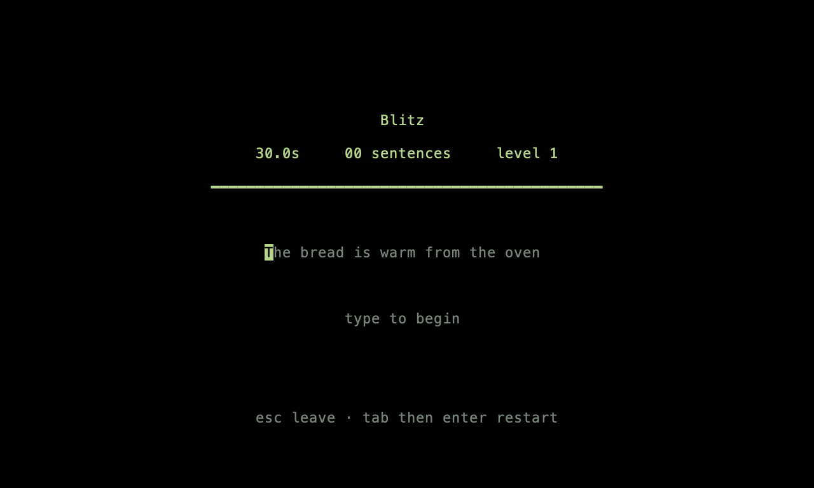
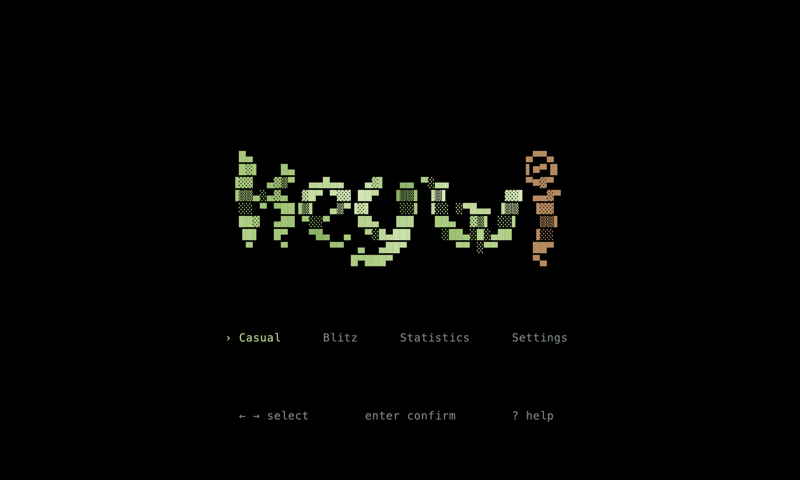
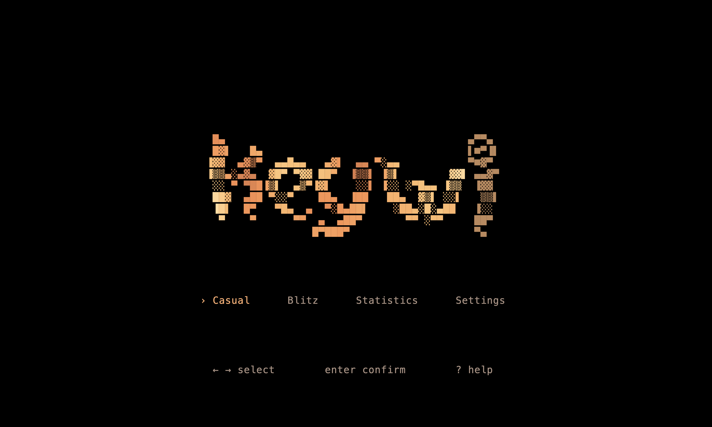
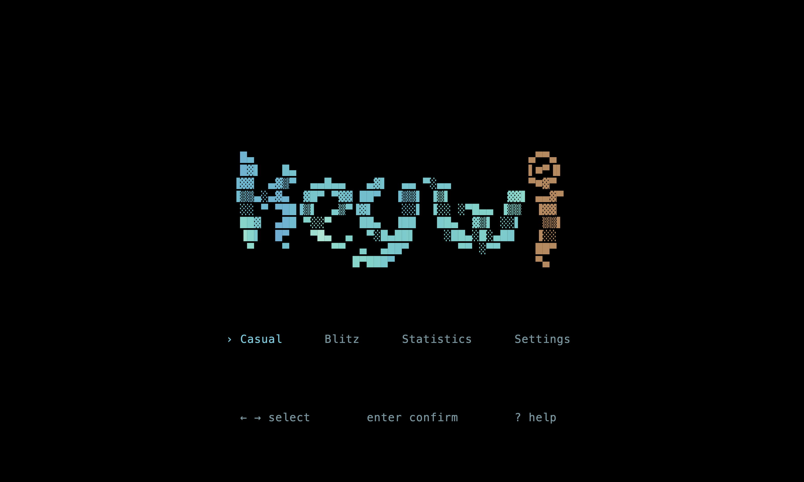
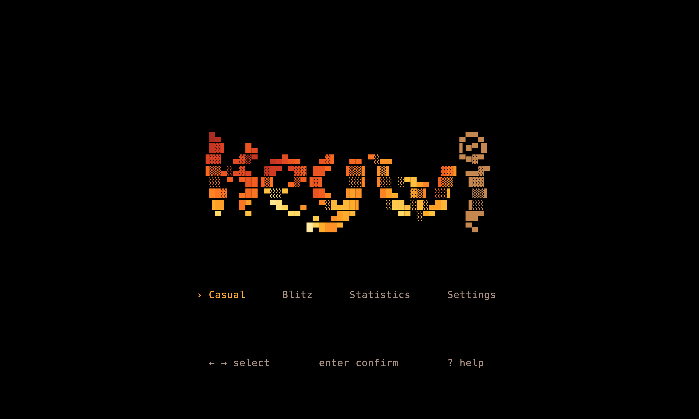
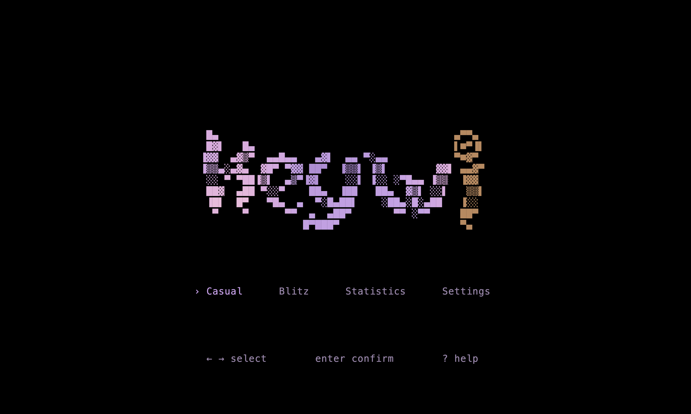
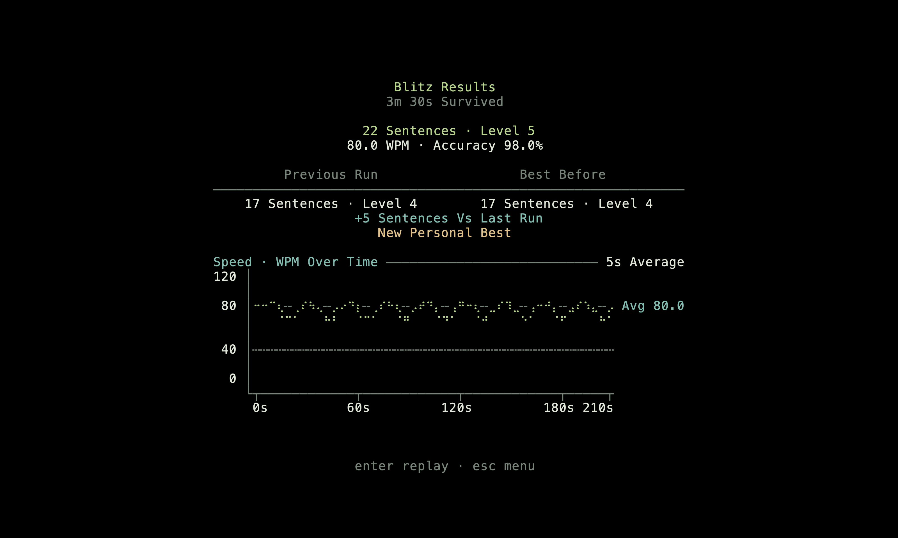
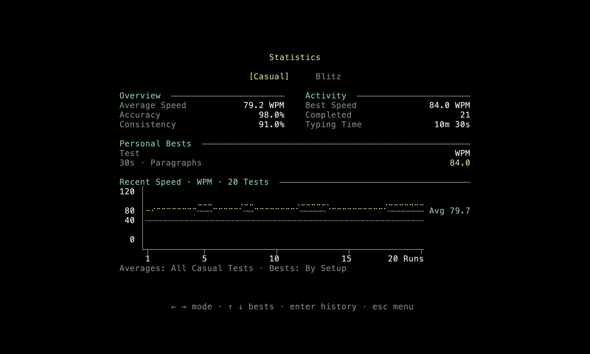

# KeyWi

## Install

macOS / Linux:

```sh
curl -fsSL https://raw.githubusercontent.com/gaurv-m/keywi/main/install.sh | sh
```

Open a new terminal, then run:

```sh
keywi
```

## Uninstall

```sh
curl -fsSL https://raw.githubusercontent.com/gaurv-m/keywi/main/install.sh | sh -s -- uninstall
```

Your settings and scores stay saved.



I had some free time, so I made KeyWi, a simple typing game for the terminal.
I built it mainly for myself, but figured other people might enjoy it too.
Everything runs offline. Your settings and scores stay on your computer.

## Casual

Choose a timed paragraph test or a set number of random words.



## Blitz

Start with 30 seconds and keep finishing sentences to stay alive.
There's no final level. I'm not that good at it either.



## Themes

Kiwi is the default. There's also Rainbow, Fall, Tide, Fire, Orchid, and Contrast.

| Kiwi | Rainbow |
| --- | --- |
|  |  |

| Fall | Tide |
| --- | --- |
|  |  |

| Fire | Orchid |
| --- | --- |
|  |  |

## Results

See your speed, accuracy, previous run, and personal bests.





Results and Statistics images use sample data.

## Controls

| Key | Action |
| --- | --- |
| Arrows | Choose an option |
| Enter | Confirm or replay |
| Backspace | Fix a mistake |
| Esc | Go back or confirm leaving |
| Tab, then Enter | Restart a run |
| ? | Help (Shift + / on a US keyboard) |
| Ctrl+C | Quit |

Sound and animations can be changed in Settings.

## Credits

Built with [Go](https://go.dev/), [Bubble Tea](https://github.com/charmbracelet/bubbletea),
and [Lip Gloss](https://github.com/charmbracelet/lipgloss).
[MIT license](LICENSE) · [Dependency licenses](third_party/licenses)

If you find a bug, open an issue and I'll fix it.

Made by G
